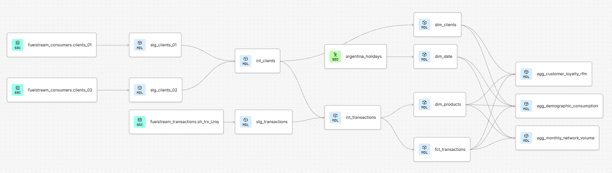

# FuelStream-Analytics: Enterprise-Grade Medallion Pipeline with dbt Cloud

## 🎯 Project Goal
The core business objective of this project is to transform a massive, production-scale dataset of over **67 million raw consumer transactions (~8 GB)** and a reference catalog of **2 million customers** into an optimized analytical data warehouse. 

By leveraging **dbt Cloud** and **Google BigQuery**, I implemented a Medallion Architecture (Bronze -> Silver -> Gold) to eliminate data anomalies, ensure customer referential integrity, and deliver analytical models optimized to evaluate customer loyalty, track monthly consumption volume, and segment demographic behavior across the service station network.

Unlike my sister project built on Databricks (which utilized a 1.5% stratified sample due to computational limits on the free tier), **this dbt pipeline processes 100% of the 67 million rows** directly inside BigQuery, capitalizing on modern ELT (Extract-Load-Transform) practices and zero-redundancy storage techniques.

---

## 🏗️ Project Architecture & Medallion Strategy

This pipeline is engineered to ensure data quality and scalability through clear separation of concerns:

- **Bronze Layer (`staging`)**: *[Completed]* Acting as the ingestion ledger. I mapped raw tables via dbt Sources, applied strict architectural standards (lowercase formatting, explicit aliases in English, and date-time parsing), and enforced governance by dropping PII (Personally Identifiable Information) columns early.
- **Silver Layer (`intermediate`)**: *[Completed]* Handles entity resolution across fragmented customer catalogs, deduplicates batch retries, enforces strict referential integrity across 67M+ transactions, and filters out unmapped records.
- **Gold Layer (`marts`)**: *[Completed]* Hybrid Star Schema (`dim_*`, `fct_*`) paired with BI-ready pre-aggregated marts (`agg_*`) designed for sub-second consumption in Looker Studio / Power BI without scanning 67M+ rows per dashboard filter.

### 📊 End-to-End Lineage Graph

---

## 🥉 Bronze Layer (Staging) Reference

I mapped and standardized the raw BigQuery infrastructure into three modular, storage-efficient dbt views:

- `stg_transactions`: Streamlines the core transaction ledger, mapping physical channels (e.g., POS codes), operational timestamps, and excluding sensitive card identifiers.
- `stg_clients_01`: Standardizes the primary consumer demographic segment.
- `stg_clients_02`: Standardizes the secondary consumer segment, parsing string dates into native `DATE` types and utilizing explicit null injections to maintain structural symmetry with segment 01.

### 🛡️ Governance & PII Controls
To ensure enterprise-grade compliance and safely present this project in a public portfolio, columns containing sensitive personal data (such as `names`, `last_names`, `emails`, and physical `card_numbers`) are explicitly filtered out at this layer, preserving only the analytical attributes (`gender`, `birth_date`, `member_status`, `account_type`).

---

## 🥈 Silver Layer (Intermediate) Reference

I consolidated the staging views into two authoritative business entities:

- `int_clients`: Unified master catalog of unique customers, deduplicated and enriched via source prioritization.
- `int_transactions`: Referentially validated and deduplicated transaction ledger with anonymized product strings, ready for dimensional aggregation.

---

## 🥇 Gold Layer (Marts — Star Schema & BI Aggregations) Reference

To balance **BigQuery Free Tier storage efficiency** with **sub-second BI query performance**, the Gold layer (`models/marts/`) combines a normalized Star Schema (`fct_transactions` materialized as a zero-storage `view`) with compact, pre-aggregated analytical tables (`agg_*` materialized as `tables`):

### Core Dimensional Star Schema
- `dim_clients` *(Grain: `person_id`)*: Casts `birth_date` to native `DATE`, computes exact customer age anchored to the dataset's operational cutoff (`2019-10-01`), sanitizes implausible age outliers outside the `18–100` range (`age = NULL`, `age_group = 'Unknown'`), segments drivers into age cohorts (`18-24` through `65+`), and classifies customers into `customer_segment` (`Commercial / Fleet` vs. `Retail / Consumer`) based on `account_type`.
- `dim_date` *(Grain: `date_id`)*: Generates a contiguous master calendar from `2016-01-01` to `2019-12-31` via BigQuery's `GENERATE_DATE_ARRAY` and enriches each date with Argentina national holidays loaded through `dbt seed` (`seeds/argentina_holidays.csv`), exposing `is_weekend`, `is_holiday`, and `holiday_name`.
- `dim_products` *(Grain: `product_id`)*: Standardizes anonymized product strings from Silver (stripping legacy brand acronyms like `VPN` and consolidating `PRODUCTO GENERI` / `PRODUCTO GENERICO` into `PRODUCTO SHOP`), classifying the 6 core catalog items into `product_category` (`Fuel`, `Lubricants`, `Convenience Store`) and `product_tier` (`Standard`, `Premium`).
- `fct_transactions` *(Grain: `transaction_id`, 63.1M+ validated rows, materialized as `view`)*: Central fact view linking foreign keys (`person_id`, `product_id`, `DATE(transacted_at) AS date_id`, `site_id`, `transaction_channel_id`) with timestamps (`transacted_at`, `registered_at`), raw and sanitized volume metrics (`quantity`, `clean_quantity`, `is_quantity_outlier`), and loyalty metrics (`points`, `points_per_unit`).

### BI-Optimized Pre-Aggregated Marts (`agg_*`)
- `agg_monthly_network_volume` *(Grain: `month_date`, `site_id`, `product_id`)*: Tracks monthly fuel/store volume (`clean_quantity`), active customers, points awarded, and weekend/holiday splits across all **701 physical service stations** (excluding high-cardinality terminal codes `transaction_channel_id` with 10,045 distinct POS IDs).
- `agg_demographic_consumption` *(Grain: `month_date`, `customer_segment`, `age_group`, `gender`, `member_status`, `product_id`)*: Enables demographic slicing and `Premium` vs. `Standard` product affinity analysis while isolating B2B fleet drivers from retail consumers.
- `agg_customer_loyalty_rfm` *(Grain: `person_id`)*: Customer-level **Recency, Frequency, and Monetary (RFM)** summary dynamically anchored to `MAX(date_id)`, tracking active months, cross-category adoption (`fuel_transactions`, `store_transactions`, `lubricants_transactions`), `premium_fuel_share`, station network breadth (`distinct_sites_visited`), and multi-dimensional loyalty tiers (`VIP Multi-Category`, `Loyal Fuel Regular`, `Occasional Active`, `At Risk`, `Churned`, `Never Transacted`).

---

## 🔍 Data Quality Audit & Business Rules

Before and during dimensional modeling, I performed a rigorous data profiling and referential integrity audit across the 67M+ transactions and fragmented customer tables to establish clear business rules across layers:

### 1. Customer Entity Resolution (`int_clients`)
- **Cross-Source Overlap:** Profiling revealed that `clients_01` and `clients_02` share **2,105,435 overlapping customer IDs** (roughly 99% of the secondary table), alongside **3 exact duplicate records** within `clients_02`.
- **Resolution Rule:** Implemented a deduplication strategy using `SELECT DISTINCT` on the secondary source followed by `ROW_NUMBER()` over a unified ledger, strictly prioritizing records from `clients_01` due to its richer attribute schema (`updated_at`, `email_status`, `is_domain_valid`) to guarantee a single, authoritative record per `person_id`.

### 2. Referential Integrity & Orphan Filtering (`int_transactions`)
- **Orphan Audit:** Cross-referencing the 67M+ transaction ledger against the unified `int_clients` master table identified **5,489 orphaned transactions** belonging to **368 unmapped `person_id` keys** (<0.01% of total volume).
- **Resolution Rule:** Orphaned transactions are explicitly filtered out in the Silver layer via an `INNER JOIN` validation against `int_clients`. Preserving only mapped records ensures strict referential integrity and prevents demographic distortion in the Gold layer.

### 3. Batch Retry Deduplication (`site_id = 361` Anomaly)
- **Duplicate Audit:** Running `dbt test --select marts` surfaced a `unique_fct_transactions_transaction_id` failure caused by **10 duplicate rows (5 pairs)** in the raw transaction stream. Inspecting the pairs in `int_transactions` revealed identical operational attributes (`person_id`, `product_id`, `quantity`, `points`, exact second-level `transacted_at`, `registered_at`, and `transaction_channel_id = 99`), differing only in `site_id`: one row logged the actual physical service station while the duplicate consistently pointed to `site_id = 361` (a system batch retry artifact).
- **Resolution Rule:** Added deterministic deduplication in `int_transactions.sql` using `QUALIFY ROW_NUMBER() OVER (PARTITION BY t.transaction_id ORDER BY CASE WHEN t.site_id = 361 THEN 2 ELSE 1 END ASC, t.registered_at DESC) = 1`, preserving the legitimate physical station transaction.

### 4. Extreme Volume Outlier Isolation & B2B Segmentation (`fct_transactions` & `dim_clients`)
- **Distribution Audit:** Profiling transaction quantities across `account_type` revealed two distinct populations: **593 Commercial/Fleet accounts** (`account_type = 2`, median `70 L`, `p90 = 682 L`) and **2.1M+ Retail consumers** (`account_type = 1`, median `27 L`, `p90 = 53 L`), alongside **6,571 extreme volume anomalies** (`0.01%` of rows exceeding `1,500 L`, including POS errors up to `70.8M L`) that severely skewed mean consumption.
- **Resolution Rule:** Preserved full transaction and loyalty point traceability in `fct_transactions` without deleting rows by flagging `is_quantity_outlier` (`quantity <= 0 OR quantity > 1500`) and exposing `clean_quantity` (`NULL` outside `(0, 1500]`) for downstream BI aggregations, while classifying `Commercial / Fleet` vs. `Retail / Consumer` in `dim_clients`.

---

## 🤖 AI-Augmented Data Governance & Self-Service Analytics (`scripts/`)

To accelerate metadata governance and enable natural-language exploration over the warehouse without exposing raw PII or incurring unnecessary compute costs, I integrated **Google Gemini AI** (`google-genai` SDK) with **BigQuery** through two standalone Python automation tools:

### 1. Automated dbt Documentation & Test Generator (`scripts/generate_dbt_docs.py`)
- **Metadata-Driven Synthesis:** Dynamically queries BigQuery's `INFORMATION_SCHEMA.COLUMNS` across Bronze (`stg_`), Silver (`int_`), and Gold (`dim_`, `fct_`, `agg_`) models to extract exact column names and data types without reading row-level data.
- **Automated YAML & dbt Fusion Quality Rules:** Uses Gemini with automatic model fallback (`gemini-3.1-flash-lite` / `gemini-3.6-flash`) to generate standardized `_stg_models.yml`, `_int_models.yml`, and `_marts_models.yml` files, drafting business descriptions, primary-key tests (`unique`, `not_null`), and modern **dbt Fusion (dbt 1.10+)** referential integrity tests (`relationships` nested under `arguments:`) validated via `dbt test` (28/28 passing) and `dbt docs generate`.

### 2. Natural Language to GoogleSQL Agent (`scripts/text_to_sql.py`)
- **Schema-Grounded Text-to-SQL:** Injects live BigQuery metadata into Gemini to translate plain-English or Spanish business questions into dialect-accurate, table-qualified **GoogleSQL**.
- **Architectural Guardrails:** Instructs the LLM to prioritize curated Gold (`agg_`, `dim_`, `fct_`) and Silver (`int_`) models over raw Bronze (`stg_`) views and enforces a strict read-only validation check (`SELECT` / `WITH` only) prior to query execution.

#### Quickstart (`scripts/`)

    # Install dependencies
    pip install google-genai google-cloud-bigquery pandas db-dtypes

    # Set environment variables
    export GEMINI_API_KEY="your_api_key"
    export GCP_PROJECT_ID="jtaguico-websites"
    export DBT_DATASET_ID="dbt_jdata"

    # 1. Regenerate dbt schema.yml definitions from BigQuery metadata
    python scripts/generate_dbt_docs.py

    # 2. Query the warehouse in natural language
    python scripts/text_to_sql.py "How many unique clients exist by loyalty_segment and customer_segment?"
    